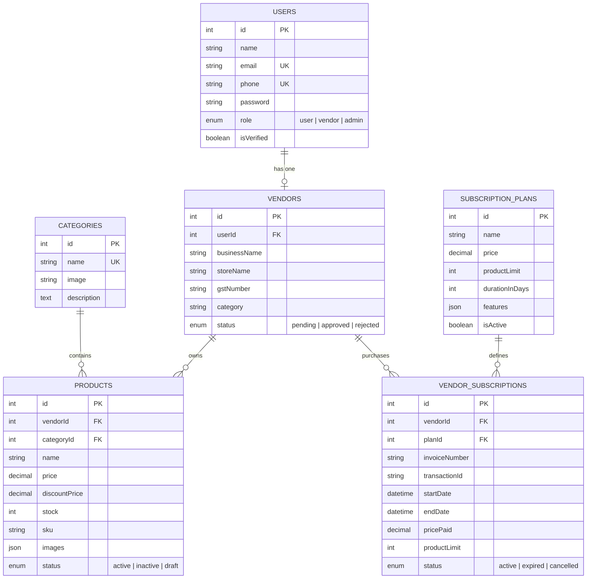

# 🛒 Multi-Vendor E-Commerce Backend Architecture & Developer Guide

Welcome to the backend engineering documentation for the **Multi-Vendor E-Commerce Marketplace**. This guide is written to onboard any new developer to the system, explaining **how data flows**, **how requests and payloads are processed**, **how role-based authorization works**, and **how the subscription quota engine operates**.

---

## 📑 Table of Contents

1. [High-Level Architecture & Request Flow](#1-high-level-architecture--request-flow)
2. [How a POST Request & Payload Actually Works](#2-how-a-post-request--payload-actually-works)
3. [Authentication & Role-Based Authorization](#3-authentication--role-based-authorization)
4. [Vendor Lifecycle: Pending vs. Approved](#4-vendor-lifecycle-pending-vs-approved)
5. [The Subscription & Product Listing Quota Engine](#5-the-subscription--product-listing-quota-engine)
6. [Database Schema & Relationships](#6-database-schema--relationships)
7. [API Route Directory & Payload Examples](#7-api-route-directory--payload-examples)
8. [Project Structure](#8-project-structure)
9. [Local Setup & Environment](#9-local-setup--environment)

---

## 1. High-Level Architecture & Request Flow

The backend is built with **Node.js**, **Express**, **MySQL**, and **Sequelize ORM**.

```
[ Client (Postman / Web App) ]
              │  HTTP Request (Headers + JSON Payload)
              ▼
    [ Express App (app.js) ]
              │  Global Middlewares (cors, morgan, express.json)
              ▼
     [ API Routers (routes/) ]
              │  Endpoint Matching (/api/auth, /api/products, etc.)
              ▼
  [ Middlewares (middlewares/) ]
              │  1. Token Verification (protect)
              │  2. Role Guard (restrictTo('admin' | 'vendor'))
              │  3. Vendor Status Guard (isApprovedVendor)
              ▼
 [ Controllers (controllers/) ]
              │  Extract req.body / req.params / req.query
              │  Business Logic & Validation
              ▼
    [ Models (Sequelize ORM) ]
              │  Execute SQL Queries
              ▼
     [ MySQL Database ]
```

---

## 2. How a POST Request & Payload Actually Works

If you are new to backend development, here is the exact step-by-step breakdown of how a client sends data and how the server receives it:

### Step 1: The Client Sends an HTTP Request
When you trigger a `POST` request (e.g. from Postman or Axios in React), the client sends two main things:
1. **Headers**: Metadata about the request.
   - `Content-Type: application/json` *(tells the server the body is JSON string)*
   - `Authorization: Bearer eyJhbGciOi...` *(your JWT authentication key)*
2. **Body (Payload)**: The actual data being sent, formatted as a JSON string:
   ```json
   {
     "name": "Mechanical Keyboard",
     "price": 3499.00,
     "stock": 25,
     "categoryId": 2
   }
   ```

### Step 2: Express Parses the Incoming Stream
In [server/src/app.js](file:///c:/Users/dell/OneDrive/Desktop/multi-vendor/server/src/app.js):
```javascript
app.use(express.json());
```
Raw HTTP requests arrive as chunks of binary data (stream). `express.json()` buffers these chunks, parses the JSON string into a native JavaScript object, and attaches it directly to `req.body`.

### Step 3: Route Matches and Dispatches to the Controller
In [server/src/routes/productRoutes.js](file:///c:/Users/dell/OneDrive/Desktop/multi-vendor/server/src/routes/productRoutes.js):
```javascript
router.post("/", protect, restrictTo("vendor"), isApprovedVendor, createProduct);
```
- First, it passes through `protect` (verifies token).
- Second, it passes through `restrictTo("vendor")` (verifies role).
- Third, it passes through `isApprovedVendor` (verifies admin approval).
- Finally, it arrives at `createProduct` in [productController.js](file:///c:/Users/dell/OneDrive/Desktop/multi-vendor/server/src/controllers/productController.js).

### Step 4: Destructuring & Validation Inside Controller
Inside `createProduct`:
```javascript
const { name, price, stock, categoryId } = req.body;

if (!name) {
    return res.status(400).json({ message: "Product name is required" });
}
```
We extract the fields using JavaScript destructuring, validate them, query or mutate the database via Sequelize models (`Product.create(...)`), and send back an HTTP response with a status code and JSON:
```javascript
res.status(201).json({
    message: "Product created successfully",
    product
});
```

---

## 3. Authentication & Role-Based Authorization

The marketplace defines 3 distinct roles:
1. **`user`**: Regular customer / shopper who browses products, places orders.
2. **`vendor`**: Merchant who registers their store, buys subscription plans, and lists products within their plan quota.
3. **`admin`**: Marketplace operator who approves/rejects vendors, creates subscription plans, and manages marketplace categories.

### 🔑 The JWT Flow

```
1. Client POST /api/auth/login with Email/Phone + Password
                     │
                     ▼
2. Server validates credentials with bcrypt.compare()
                     │
                     ▼
3. Server generates JWT Token with payload: { id: user.id, role: user.role }
                     │
                     ▼
4. Client stores Token and sends it in header: "Authorization: Bearer <token>"
```

### 🛡️ The 3 Defense Middlewares

Located in [server/src/middlewares/authMiddleware.js](file:///c:/Users/dell/OneDrive/Desktop/multi-vendor/server/src/middlewares/authMiddleware.js):

#### 1. `protect`
- Reads `req.headers.authorization`.
- Extracts the token after `"Bearer "`.
- Decodes it with `jwt.verify(token, process.env.JWT_SECRET)`.
- Fetches the user from the database (eagerly loading their `vendorProfile`).
- Attaches the user object to `req.user`.

#### 2. `restrictTo(...roles)`
- Checks `req.user.role`.
- Example: `router.use(protect, restrictTo("admin"))` blocks anyone whose role is not `admin` with a `403 Forbidden` response.

#### 3. `isApprovedVendor`
- Specifically checks `req.user.vendorProfile.status === "approved"`.
- Prevents pending or rejected vendors from uploading products or accessing vendor dashboard endpoints.

---

## 4. Vendor Lifecycle: Pending vs. Approved

A critical rule in this marketplace is that **Vendors cannot log in or perform actions immediately after registration**.

```
[ Vendor Registers ] ──> Status: "pending" | isVerified: false
                              │
                              ▼
                     [ Cannot Log In ] ──> Returns 401 "Pending Admin Approval"
                              │
                              ▼
          [ Admin Reviews: PUT /api/vendors/:id/approve ]
                              │
                              ├──> Sets vendor.status = "approved"
                              ├──> Sets user.isVerified = true
                              └──> Sends Approval Email via Nodemailer
                              │
                              ▼
                     [ Vendor Can Now Log In! ]
```

- **Customers (`user`) & Admins (`admin`)**: Can log in immediately upon registration (`isVerified: true`).
- **Vendors (`vendor`)**: Must be reviewed by Admin. Rejection is handled via `PUT /api/vendors/:id/reject` with an optional rejection reason.

---

## 5. The Subscription & Product Listing Quota Engine

Vendors cannot list products for free or infinitely. Listing is governed by a **Subscription Plan Quota Engine**.

### How It Works:

1. **Admin Sets Up Plans:**
   Admin creates plans via `POST /api/admin/plans`. Each plan specifies:
   - `price`: Plan cost (e.g. ₹999.00)
   - `productLimit`: Max number of products vendor can list (e.g. 50 products)
   - `durationInDays`: Validity period (e.g. 30 days)

2. **Vendor Purchases a Plan:**
   Vendor browses plans via `GET /api/subscriptions/plans` and purchases via `POST /api/subscriptions/purchase`.
   - Generates an official `invoiceNumber` (e.g. `INV-202610-482910-V5`).
   - Generates a `transactionId`.
   - Computes `startDate` (now) and `endDate` (`startDate + durationInDays`).
   - If vendor already had an active plan of the same tier, it treats it as a **renewal** and extends from the existing expiry date!

3. **Quota Enforcement on Product Creation (`POST /api/products`):**
   Before a product is saved, the controller checks:
   ```javascript
   // 1. Is vendor approved?
   if (vendor.status !== "approved") return 403;

   // 2. Does vendor have an active subscription?
   if (!activeSubscription) return 403 "No active subscription plan found";

   // 3. Has the subscription expired?
   if (new Date() > new Date(activeSubscription.endDate)) {
       activeSubscription.status = "expired";
       await activeSubscription.save();
       return 403 "Your subscription has expired. Please renew.";
   }

   // 4. Has the vendor reached the product limit?
   const currentCount = await Product.count({ where: { vendorId: vendor.id } });
   if (currentCount >= activeSubscription.productLimit) {
       return 403 `Limit reached! Your plan allows up to ${activeSubscription.productLimit} products.`;
   }
   ```

4. **Slot Recovery on Deletion:**
   When a vendor deletes a product (`DELETE /api/products/:id`), that slot becomes free again immediately.

---

## 6. Database Schema & Relationships



---

## 7. API Route Directory & Payload Examples

### 🔐 1. Authentication (`/api/auth`)

#### Universal Registration
`POST /api/auth/register`
```json
// Customer Registration
{
  "name": "John Doe",
  "email": "john@example.com",
  "phone": "9876543210",
  "password": "Password@123",
  "role": "user"
}

// Vendor Registration
{
  "name": "Jane Vendor",
  "email": "jane@store.com",
  "phone": "9876543211",
  "password": "Password@123",
  "role": "vendor",
  "businessName": "Jane Electronics Pvt Ltd",
  "storeName": "Jane Gadgets",
  "gstNumber": "27AAAAA0000A1Z5",
  "category": "Electronics"
}
```

#### Universal Login (Email OR Phone)
`POST /api/auth/login`
```json
{
  "emailOrPhone": "jane@store.com",
  "password": "Password@123"
}
```

---

### 👑 2. Admin Operations (`/api/admin`)
*Requires `Authorization: Bearer <ADMIN_TOKEN>`*

- **Create Subscription Plan:** `POST /api/admin/plans`
  ```json
  {
    "name": "Silver Plan",
    "description": "Ideal for small sellers",
    "price": 499.00,
    "productLimit": 25,
    "durationInDays": 30,
    "features": ["25 Products", "Standard Support"]
  }
  ```
- **List All Plans:** `GET /api/admin/plans`
- **Create Category:** `POST /api/admin/categories`
  ```json
  {
    "name": "Fashion & Apparel",
    "image": "https://example.com/fashion.png",
    "description": "Men and women clothing"
  }
  ```
- **Reset DB for Testing:** `POST /api/admin/dropexist` *(Drops and recreates fresh schema)*

---

### 🏪 3. Vendor Oversight (`/api/vendors`)
*Requires `Authorization: Bearer <ADMIN_TOKEN>`*

- **List All Vendors:** `GET /api/vendors?status=pending`
- **Approve Vendor:** `PUT /api/vendors/:id/approve`
- **Reject Vendor:** `PUT /api/vendors/:id/reject`
  ```json
  {
    "reason": "Invalid GST Number provided."
  }
  ```

---

### 💳 4. Vendor Subscriptions (`/api/subscriptions`)

- **Browse Active Plans:** `GET /api/subscriptions/plans` *(Public)*
- **Preview Checkout:** `POST /api/subscriptions/preview` *(Vendor only)*
  ```json
  { "planId": 1 }
  ```
- **Purchase Plan:** `POST /api/subscriptions/purchase` *(Vendor only)*
  ```json
  {
    "planId": 1,
    "paymentMethod": "card"
  }
  ```
- **Check My Subscription & Remaining Days:** `GET /api/subscriptions/my-subscription` *(Vendor only)*
- **Subscription History:** `GET /api/subscriptions/history` *(Vendor only)*
- **Get Invoice Details:** `GET /api/subscriptions/invoice/:id` *(Vendor or Admin)*

---

### 📦 5. Products (`/api/products`)

- **List New Product:** `POST /api/products` *(Vendor only)*
  ```json
  {
    "name": "Wireless Noise Cancelling Earbuds",
    "description": "Active noise cancellation with 30-hour battery life",
    "price": 2999.00,
    "discountPrice": 2499.00,
    "stock": 50,
    "sku": "EAR-ANC-01",
    "categoryId": 1,
    "images": [
      "https://example.com/earbuds1.jpg",
      "https://example.com/earbuds2.jpg"
    ]
  }
  ```
- **Vendor's My Products + Quota:** `GET /api/products/my-products` *(Vendor only)*
- **Public Catalog:** `GET /api/products?search=earbuds&minPrice=1000&maxPrice=5000&sortBy=price_asc`
- **Product Details:** `GET /api/products/:id`
- **Update Product:** `PUT /api/products/:id` *(Vendor owner or Admin)*
- **Delete Product:** `DELETE /api/products/:id` *(Frees up 1 quota slot)*

---

## 8. Project Structure

```
server/
├── index.js                  # Server entry point & DB startup
├── package.json
├── .env                      # Database & JWT configurations
└── src/
    ├── app.js                # Express app setup & route mounting
    ├── config/
    │   ├── db.js             # Sequelize instance & schema sync helper
    │   └── mail.js           # Nodemailer transport config
    ├── controllers/
    │   ├── adminController.js         # Plan CRUD, Categories CRUD, DB reset
    │   ├── authController.js          # Unified Register, Login, Me
    │   ├── productController.js       # Product CRUD with quota enforcement
    │   ├── subscriptionController.js  # Plan purchase, preview, invoice
    │   └── vendorController.js        # Admin vendor approval/rejection
    ├── middlewares/
    │   └── authMiddleware.js          # protect, restrictTo, isApprovedVendor
    ├── models/
    │   ├── index.js                   # Barrel export & Sequelize associations
    │   ├── userModel.js               # User accounts
    │   ├── vendorModel.js             # Store profiles
    │   ├── subscriptionPlanModel.js   # Admin plan definitions
    │   ├── vendorSubscriptionModel.js # Active subscriptions & invoices
    │   ├── categories.js              # Store categories
    │   └── productModel.js            # Listed products
    ├── routes/
    │   ├── adminRoutes.js
    │   ├── authRoutes.js
    │   ├── categoryRoutes.js
    │   ├── productRoutes.js
    │   ├── subscriptionRoutes.js
    │   └── vendorRoute.js
    └── utils/
        └── jwt.js                     # generateToken & verifyToken helpers
```

---

## 9. Local Setup & Environment

### Prerequisites
- Node.js (v18+)
- MySQL (v8.0+ or XAMPP / MariaDB)

### Configuration (`server/.env`)
```env
PORT=8000
DB_HOST=localhost
DB_USER=root
DB_PASSWORD=
DB_NAME=multi_vendor
DB_PORT=3306

JWT_SECRET=your_super_secret_jwt_key_here
JWT_EXPIRES_IN=7d

EMAIL_USER=your_email@gmail.com
EMAIL_PASS=your_email_app_password
```

### Running Locally
```bash
cd server
npm install
npm run dev
```

Server will start on `http://localhost:8000`. Database tables and column migrations synchronize automatically on startup.
